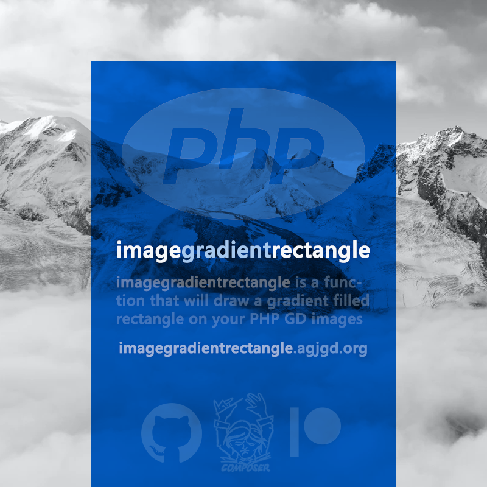

# imagegradientrectangle

## Description

**imagegradientrectangle** is a function that will draw a gradient filled rectangle on your PHP GD images.

As of **v2.0.0** imagegradientrectangle is part of [**AgjGd**](https://agjgd.org). The implementation now lives in the `\AndrewGJohnson\AgjGd` class provided by the [`andrewgjohnson/agjgd`](https://packagist.org/packages/andrewgjohnson/agjgd) package, and this package provides the standalone `imagegradientrectangle()` function as a thin reverse-compatibility wrapper around it.

New code should call [`\AndrewGJohnson\AgjGd::imagegradientrectangle()`](https://agjgd.org/methods/imagegradientrectangle/) directly.

**imagegradientrectangle** is an [agjgd](https://agjgd.org) project.

## Examples

    $red  = imagecolorallocate($im, 0xFF, 0x00, 0x00);
    $blue = imagecolorallocate($im, 0x00, 0x00, 0xFF);

    // Standard method to draw solid filled rectangles
    imagefilledrectangle($im, 10, 10, 100, 100, $red);
    imagefilledrectangle($im, 10, 10, 100, 100, $blue);

    // This will draw a red-to-blue gradient filled rectangle (vertical gradient)
    imagegradientrectangle($im, 10, 10, 100, 100, $red, $blue);

    // This will draw a red-to-blue gradient filled rectangle (horizontal gradient)
    imagegradientrectangle($im, 10, 10, 100, 100, $red, $blue, true);

There are [other examples](https://github.com/andrewgjohnson/imagegradientrectangle/tree/master/examples) included in the GitHub repository and on [imagegradientrectangle.agjgd.org](https://imagegradientrectangle.agjgd.org/examples/).

## Usage

### With Composer

This project offers support for the [Composer](https://getcomposer.org/) dependency manager. You can find the imagegradientrectangle package online on [packagist.org](https://packagist.org/packages/andrewgjohnson/imagegradientrectangle).

#### Install using Composer

Either run this command:

    composer require andrewgjohnson/imagegradientrectangle

or add this to the `require` section of your composer.json file:

    "andrewgjohnson/imagegradientrectangle": "^2.0"

This package requires PHP 8.0 or newer, the [GD extension](https://www.php.net/manual/book.image.php) and the [`andrewgjohnson/agjgd`](https://packagist.org/packages/andrewgjohnson/agjgd) package, which Composer installs automatically.

### Without Composer

Because `imagegradientrectangle()` now forwards to the `\AndrewGJohnson\AgjGd` class, you need both this wrapper and AgjGd. Composer is the recommended way to install them, but you can also require both source files directly:

    require_once 'path/to/agjgd/source/AndrewGJohnson/AgjGd.php';
    require_once 'source/imagegradientrectangle.php';

### Dependencies

As of v2.0.0 this project has a single dependency, [`andrewgjohnson/agjgd`](https://packagist.org/packages/andrewgjohnson/agjgd), which provides the `\AndrewGJohnson\AgjGd` class this wrapper forwards to. Prior to v2.0.0 this project depended on [imageblendedcolorallocate](https://github.com/andrewgjohnson/imageblendedcolorallocate), which AgjGd now supersedes.

## Help Requests

Please post any questions in the [discussions area](https://github.com/andrewgjohnson/imagegradientrectangle/discussions) on GitHub if you need help.

If you discover a bug please [enter an issue](https://github.com/andrewgjohnson/imagegradientrectangle/issues/new) on GitHub. When submitting an issue please use our [issue templates](https://github.com/andrewgjohnson/imagegradientrectangle/tree/master/.github/ISSUE_TEMPLATE).

## Contributing

Please read our [contributing guidelines](https://github.com/andrewgjohnson/imagegradientrectangle/blob/master/.github/CONTRIBUTING.md) if you want to contribute.

You can contribute financially by becoming a [patron](https://patreon.com/agjopensource) at [patreon.com/agjopensource](https://patreon.com/agjopensource) to support imagegradientrectangle and [other agjgd.org projects](https://agjgd.org/projects/).

## Acknowledgements

This project was started by [Andrew G. Johnson (@andrewgjohnson)](https://github.com/andrewgjohnson).

Full list of contributors:
 * [Andrew G. Johnson (@andrewgjohnson)](https://github.com/andrewgjohnson)

Our [security policies and procedures](https://github.com/andrewgjohnson/imagegradientrectangle/blob/master/.github/SECURITY.md) come via the [atomist/samples](https://github.com/atomist/samples/blob/master/SECURITY.md) project. Our [issue templates](https://github.com/andrewgjohnson/imagegradientrectangle/tree/master/.github/ISSUE_TEMPLATE) come via the [tensorflow/tensorflow](https://github.com/tensorflow/tensorflow/blob/master/SECURITY.md) project. Our [pull request template](https://github.com/andrewgjohnson/imagegradientrectangle/blob/master/.github/PULL_REQUEST_TEMPLATE.md) comes via the [stevemao/github-issue-templates](https://github.com/stevemao/github-issue-templates) project. The [Jekyll theme](https://github.com/andrewgjohnson/open-source-documentation-jekyll-theme) was released by [Andrew G. Johnson](https://github.com/andrewgjohnson).

## Changelog

You can find all notable changes in the [changelog](https://github.com/andrewgjohnson/imagegradientrectangle/blob/master/CHANGELOG.md).
